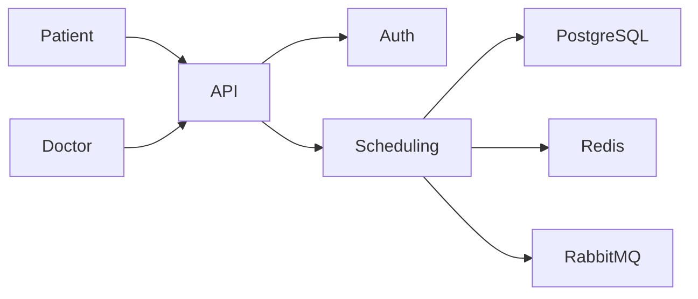

# Hospital Appointment Scheduling System Engine

## Executive Summary

This README is derived from the uploaded design document.

### Features

- Patient Management
- Practitioner Management
- Appointment Scheduling
- Waitlist Management
- OAuth2/JWT Authentication
- RBAC Authorization
- REST APIs
- PostgreSQL
- Redis
- RabbitMQ
- Kubernetes

## Architecture

## Core Entities

- Patient
- Practitioner
- Appointment
- Time Slot
- Waitlist
- Department
- Specialty
- User & Roles
- Audit Log

## REST APIs

- POST /api/patients
- GET /api/patients/{id}
- POST /api/appointments
- GET /api/appointments/{id}
- PUT /api/appointments/{id}
- DELETE /api/appointments/{id}

## Technology Stack

| Layer | Technology |
|---|---|
| Backend | Spring Boot / Express / FastAPI |
| Database | PostgreSQL |
| Cache | Redis |
| Queue | RabbitMQ / SQS |
| Auth | OAuth2 / JWT |
| Deployment | Docker + Kubernetes |

## Security

- HTTPS/TLS
- AES-256 Encryption
- JWT Authentication
- RBAC
- Audit Logs
- Rate Limiting

## Deployment

- API Gateway
- Microservices
- PostgreSQL
- Redis
- Message Queue
- Notification Service

## Conclusion

The document recommends a scalable microservices-based hospital appointment scheduling system with secure APIs, ACID-compliant database transactions, waitlist management, and cloud-native deployment.
